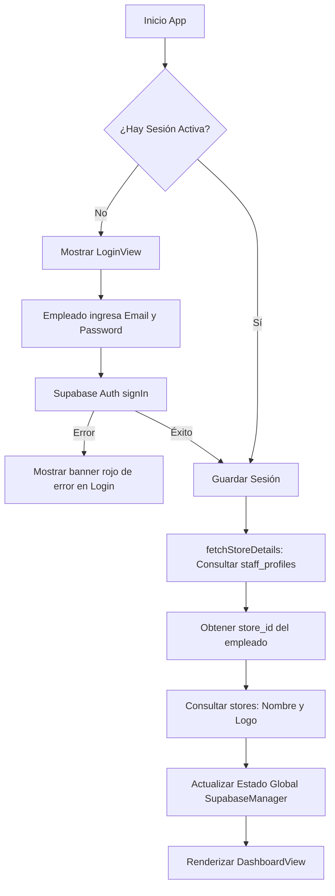

# Especificación y Análisis Completo: Productibot QR SCAN para Google Play Store

> **Documento de Especificación de Producto y Arquitectura Técnica**  
> **Proyecto:** Productibot Loyalty Scan / Productibot QR SCAN  
> **Objetivo:** Replicar la aplicación nativa de iOS en Android para su publicación y distribución en Google Play Store.  
> **Fecha:** Octubre 2026  
> **Versión Objetivo Android:** 1.0.0 (equivalente a iOS v1.0.2 / Build 3)  
> **Autor/Desarrollador:** Alain Jean Paul Raimond Kedilhac Ruiz / Waves Management  

---

## Índice General

1. [Resumen Ejecutivo del Proyecto](#1-resumen-ejecutivo-del-proyecto)
2. [Análisis Técnico Exhaustivo de la App iOS Actual](#2-análisis-técnico-exhaustivo-de-la-app-ios-actual)
   - 2.1 Identidad y Configuración
   - 2.2 Stack y Dependencias iOS
   - 2.3 Modelo de Datos y Backend (Supabase)
3. [Lógica de Negocio y Algoritmos de Procesamiento](#3-lógica-de-negocio-y-algoritmos-de-procesamiento)
   - 3.1 Flujo de Autenticación de Personal
   - 3.2 Algoritmo de Detección Inteligente de QR
   - 3.3 Canje de Cupones de Recompensa
   - 3.4 Acumulación de Sellos y Visitas (RPC)
4. [Especificación Detallada de Pantallas y UI/UX](#4-especificación-detallada-de-pantallas-y-uiux)
   - 4.1 Pantalla 0: Enrutador y Tema Global
   - 4.2 Pantalla 1: Inicio de Sesión (`LoginView`)
   - 4.3 Pantalla 2: Panel de Control (`DashboardView`)
   - 4.4 Pantalla 3: Terminal de Escaneo de Cámara (`ScanQRView`)
   - 4.5 Pantalla 4: Modal de Resultados y Estados de Respuesta
5. [Arquitectura Técnica Recomendada para Android](#5-arquitectura-técnica-recomendada-para-android)
   - 5.1 Stack Seleccionado (Kotlin + Jetpack Compose)
   - 5.2 Tabla de Equivalencias Tecnológicas (iOS vs. Android)
   - 5.3 Estructura de Directorios del Proyecto Android
6. [Implementación de Código Clave en Android](#6-implementación-de-código-clave-en-android)
   - 6.1 Configuración de Dependencias Gradle (`build.gradle.kts`)
   - 6.2 Cliente Supabase y Modelos de Datos en Kotlin
   - 6.3 Escáner de Cámara con CameraX y Google ML Kit
7. [Permisos y Manifiesto de Android (`AndroidManifest.xml`)](#7-permisos-y-manifiesto-de-android-androidmanifestxml)
8. [Requisitos Oficiales para Google Play Store](#8-requisitos-oficiales-para-google-play-store)
   - 8.1 Identidad y Metadatos de la Ficha en Play Console
   - 8.2 Activos Gráficos Requeridos (Dimensiones y Formatos)
   - 8.3 Formulario de Seguridad de Datos (Google Play Data Safety)
   - 8.4 Declaración de Permisos Críticos (Cámara)
9. [Checklist y Hoja de Ruta de Implementación](#9-checklist-y-hoja-de-ruta-de-implementación)

---

## 1. Resumen Ejecutivo del Proyecto

La aplicación **Productibot QR SCAN** es una herramienta operativa para terminales de punto de venta (POS) y dispositivos del personal en sucursales comerciales. Su función esencial es:
1. Permitir que los empleados de la tienda inicien sesión de forma segura.
2. Identificar la sucursal y el perfil del empleado activo.
3. Escanear a alta velocidad códigos QR presentados por los clientes en tarjetas digitales (Apple Wallet, Google Wallet o Web App) o cupones de premios.
4. Procesar transacciones en tiempo real con Supabase:
   - Registro y acumulación de sellos/visitas con desbloqueo de recompensas.
   - Validación y canje seguro de cupones promocionales con prevención de doble gasto.
5. Brindar retroalimentación audiovisual e háptica inmediata al operador en caja.

Este documento establece la guía completa de diseño, ingeniería, equivalencias técnicas y políticas de publicación para construir la versión de Android 100% fiel a la experiencia de iOS y publicarla en Google Play Store.

---

## 2. Análisis Técnico Exhaustivo de la App iOS Actual

### 2.1 Identidad y Configuración
- **Nombre del Proyecto:** `ProductibotLoyaltyScan`
- **Nombre para Mostrar (Display Name):** `Productibot QR SCAN`
- **Bundle ID iOS:** `com.wavesmanagement.ProductibotLoyaltyScan`
- **ID de Paquete Android Recomendado:** `com.wavesmanagement.productibotqrscan` o `com.wavesmanagement.productibotloyaltyscan`
- **Versión iOS:** 1.0.2 (Build 3)
- **Orientación:** Bloqueada exclusivamente a Vertical (`Portrait`)
- **Esquema de Color:** Modo Oscuro Forzado (`Dark Theme`) con paleta de azules profundos, cian y acentos de estado (verde, amarillo, rojo).

### 2.2 Stack y Dependencias iOS
- **Lenguaje:** Swift 5.9+
- **Framework de UI:** SwiftUI (Target iOS 16.0+)
- **Librerías Externas:**
  - `supabase-swift` (v2.22.0): Autenticación, queries PostgREST y llamadas a RPC.
  - `CodeScanner` (v2.3.3 de Paul Hudson / TwoStraws): Wrapper sobre AVFoundation para captura de QR en tiempo real con linterna.
  - `AudioToolbox`: Reproducción de sonido de sistema (Beep `1057`).
  - `UIKit Feedback Generators`: Haptics táctiles (`UIImpactFeedbackGenerator`, `UINotificationFeedbackGenerator`).

### 2.3 Modelo de Datos y Backend (Supabase)
- **URL Base:** `https://mnhwtwsbobwjkymiuora.supabase.co`
- **API Key:** Anon Key JWT configurada estáticamente.
- **Store ID por defecto:** `c3ad358a-6412-412e-87f9-8c50986b3298` (se sobrescribe dinámicamente con el asignado al empleado).

#### Tablas Consumidas y Operaciones:
| Tabla / Endpoint | Operación | Propósito | Filtros / Condiciones |
|---|---|---|---|
| `auth.users` | `signIn`, `signOut` | Autenticación con email y contraseña del cajero/empleado | Credenciales directas |
| `staff_profiles` | `SELECT` | Obtener sucursal asignada (`store_id`), nombre completo (`full_name`) y rol (`role`) | `id = session.user.id` |
| `stores` | `SELECT` | Obtener nombre comercial (`name`) y logotipo (`logo_url`) de la sucursal | `id = targetStoreId` |
| `coupons` | `SELECT` | Buscar si el UUID escaneado corresponde a un cupón de premio | `id = uuid` |
| `coupons` | `UPDATE` | Marcar cupón como canjeado (`status = 'redeemed'`, `redeemed_at = now`, `redeemed_by = staffId`) | `id = coupon.id` |
| `profiles` | `SELECT` | Buscar si el UUID escaneado corresponde al perfil de un cliente (`id, full_name, email`) | `id = uuid` (o `id = coupon.profile_id`) |
| `rpc/increment_visits` | `RPC (POST)` | Incrementar sellos/visitas y evaluar si se completó el ciclo | `p_profile_id`, `p_store_id`, `p_amount: 1` |
| `loyalty_transactions` | `INSERT` | Registro inmutable de auditoría para cada visita o canje | `store_id, profile_id, visits_change, description, staff_id` |

---

## 3. Lógica de Negocio y Algoritmos de Procesamiento

### 3.1 Flujo de Autenticación de Personal


### 3.2 Algoritmo de Detección Inteligente de QR
El código QR escaneado puede venir como un UUID crudo o como una URL que contiene un UUID. La aplicación ejecuta una extracción por expresión regular:
$$\text{Regex}: [0-9a-fA-F]{8}-[0-9a-fA-F]{4}-[0-9a-fA-F]{4}-[0-9a-fA-F]{4}-[0-9a-fA-F]{12}$$

Una vez extraído el UUID en minúsculas:
1. **Paso 1: ¿Es un Cupón?**
   - Consulta `coupons` donde `id = uuid`.
   - Si existe:
     - Valida `coupon.store_id == activeStoreId`. Si no coincide: **Error "Sucursal Incorrecta"**.
     - Valida `coupon.status != "redeemed"`. Si ya está canjeado: **Error "Cupón Ya Canjeado"**.
     - Si es válido:
       - Actualiza cupón a `redeemed`.
       - Inserta registro en `loyalty_transactions` con `visits_change = 0` y descripción `"Canje Premio: <Premio>"`.
       - Obtiene el nombre del cliente desde `profiles`.
       - Retorna resultado tipo **Reward (Premio Canjeado)**.
2. **Paso 2: ¿Es un Perfil de Cliente?**
   - Si no era cupón, consulta `profiles` donde `id = uuid`.
   - Si existe:
     - Invoca la función almacenada `increment_visits(p_profile_id, p_store_id, p_amount: 1)`.
     - Inserta registro en `loyalty_transactions` con `visits_change = 1` y descripción `"Visita Registrada"`.
     - Evalúa `cycle_unlocked`:
       - Si `cycle_unlocked == true`: Retorna resultado tipo **Reward ("🎉 ¡Tarjeta Completada!")**.
       - Si `cycle_unlocked == false`: Retorna resultado tipo **Visit ("⭐ ¡Visita Registrada!", "X de Y sellos")**.
3. **Paso 3: Código No Reconocido**
   - Si no coincide con ninguna tabla: Retorna resultado tipo **Error ("Código No Reconocido")**.

---

## 4. Especificación Detallada de Pantallas y UI/UX

El diseño visual es premium, de alto contraste para visibilidad en ambientes comerciales y optimizado para escaneo continuo con una sola mano.

### 4.1 Pantalla 0: Enrutador y Tema Global
- Fondo global: Gradiente vertical oscuro (`#121724` a `#0A0D14`).
- Halo de luz ambiental difuminado en azul cian.
- Transición suave (`Crossfade`) entre Login y Dashboard según el estado `isAuthenticated`.

### 4.2 Pantalla 1: Inicio de Sesión (`LoginView`)
- **Header:**
  - Círculo de 88x88 con borde azul/cian y glifo `qrcode.viewfinder`.
  - Título principal: `Productibot QR SCAN` (26pt, Bold, Rounded).
  - Subtítulo: `Terminal de Escaneo para Personal` (14pt, 60% opacidad blanco).
- **Banner de Error:**
  - Contenedor rectangular con esquinas redondeadas (12dp), fondo rojo translúcido (`rgba(239, 68, 68, 0.12)`), borde rojo y texto de error detallado.
- **Formulario:**
  - Campo Email: Icono de sobre, tipografía clara, teclado `emailAddress`, autocorrección desactivada.
  - Campo Contraseña: Icono de candado, campo seguro con botón de ojo para alternar visibilidad (`eye` / `eye.slash`).
- **Botón de Acción:**
  - Gradiente azul vibrante (`#2673F2` a `#1447BF`), esquinas redondeadas (14dp), sombra azul elevada.
  - Texto: "Iniciar Sesión" (o spinner circular `ProgressIndicator` cuando está en proceso de red).
  - Deshabilitado con opacidad 0.5 si los campos están vacíos o si está cargando.

### 4.3 Pantalla 2: Panel de Control (`DashboardView`)
- **Barra Superior (Header):**
  - Nombre de la sucursal activa en tipografía grande destacada (`supabase.storeName ?? "Productibot Scan"`).
  - Nombre del empleado o rol activo (`supabase.staffName ?? "Terminal de Escaneo"`).
  - Botón "Salir" (cápsula con icono de logout, borde translúcido). Al presionar, abre diálogo de confirmación nativo para evitar cierres de sesión accidentales.
- **Hero Central (Botón de Escaneo):**
  - Botón circular gigante (210dp de diámetro) con gradiente azul profundo y borde biselado reflectivo.
  - Anillo de onda/pulso exterior (250dp) con animación infinita continua de respiración (`scaleEffect: 0.96 -> 1.08`, `opacity: 0.8 -> 0.3`).
  - Icono central de visor QR (64pt).
  - Texto en negrita: `ESCANEAR QR`, con subtítulo `"Toca para abrir cámara"`.
  - Efecto de presión elástica suave (`ScaleButton` con animación spring).
  - Indicador de estado debajo del botón: Punto verde brillante tipo LED con sombra verde + texto `"Listo para escanear tarjetas y cupones"`.
- **Sección Inferior (Último Escaneo):**
  - Si hay un escaneo reciente (`lastScanResult != nil`), se muestra una tarjeta flotante:
    - Icono circular con color según el tipo (Verde para Visita, Amarillo/Dorado para Premio, Rojo para Error).
    - Título del resultado + etiqueta "Reciente".
    - Nombre del cliente en color cian vibrante.
    - Subtítulo descriptivo con cantidad de sellos o premio canjeado.

### 4.4 Pantalla 3: Terminal de Escaneo de Cámara (`ScanQRView`)
- **Cámara:**
  - Vista previa a pantalla completa sin bandas negras (`Crop / AspectFill`).
  - Detección instantánea en modo single-shot continuo.
- **Barra de Control Superior:**
  - Botón "Cerrar" a la izquierda (cápsula frosted glass con sombra).
  - Botón de linterna / flash a la derecha (círculo frosted glass; se ilumina en amarillo al activarse).
- **Retícula del Viewfinder:**
  - Recuadro central de 260x260dp con esquinas destacadas redondeadas en color azul cian brillante (`#3399FF`, grosor 4dp).
  - Línea láser horizontal animada con gradiente cian y resplandor neón que se desplaza arriba y abajo de forma continua.
  - Píldora inferior flotante con texto guía: `"Apunta al código QR del cliente o cupón"`.
- **Efectos al detectar código:**
  - Sonido Beep agudo inmediato.
  - Vibración háptica instantánea en el dispositivo.
  - Overlay de espera `"Validando en el sistema..."` con spinner animado mientras consulta Supabase.

### 4.5 Pantalla 4: Modal de Resultados y Estados de Respuesta
Aparece como una tarjeta modal flotante sobre la cámara con fondo oscuro semitransparente:
- **Caso 1: Visita Registrada (Éxito)**
  - Icono: Círculo verde con checkmark grande.
  - Título: `⭐ ¡Visita Registrada!`
  - Nombre del Cliente: `[Nombre del Cliente]` (con icono de persona en cian).
  - Subtítulo: `X de Y sellos acumulados` (ej. "7 de 10 sellos acumulados").
  - Detalle: `+1 Sello añadido a su tarjeta de lealtad.`
- **Caso 2: Tarjeta Completada (Desbloqueo de Ciclo)**
  - Icono: Círculo dorado/amarillo con icono de regalo (`gift`).
  - Título: `🎉 ¡Tarjeta Completada!`
  - Nombre del Cliente: `[Nombre del Cliente]`.
  - Subtítulo: `¡Desbloqueó: [Título del Premio]!`
  - Detalle: `Se generó su cupón de premio automáticamente.`
- **Caso 3: Premio Canjeado (Cupón)**
  - Icono: Círculo dorado con regalo.
  - Título: `¡Premio Canjeado!`
  - Nombre del Cliente: `[Nombre del Cliente]`.
  - Subtítulo: `[Descripción de la Recompensa]`.
  - Detalle: `Premio canjeado con éxito y registrado en el historial.`
- **Caso 4: Errores Comunes**
  - Icono: Círculo rojo con señal de alerta / octágono.
  - Título: `Código No Válido` / `Sucursal Incorrecta` / `Cupón Ya Canjeado` / `Código No Reconocido`.
  - Subtítulo explicativo claro para el empleado.
- **Botones del Modal:**
  - Botón Principal: `[Escanear Otro]` (azul brillante, restablece el escáner inmediatamente sin salir de la cámara).
  - Botón Secundario: `[Terminar]` (texto blanco translúcido, cierra la cámara y regresa al Dashboard).

---

## 5. Arquitectura Técnica Recomendada para Android

### 5.1 Stack Seleccionado (Kotlin + Jetpack Compose)
Para lograr una paridad del 100% con SwiftUI, rendimiento nativo a 60/120 fps en la cámara y compatibilidad total con los lineamientos de Google Play Console:
- **Lenguaje:** Kotlin 2.0+
- **UI Toolkit:** Jetpack Compose (Material 3)
- **Gestión de Estados:** Jetpack ViewModel + `StateFlow` / Coroutines
- **Motor de Cámara:** AndroidX CameraX (Lifecycle + Camera2)
- **Motor de Escaneo:** Google ML Kit Barcode Scanning (procesamiento en dispositivo sin latencia de red)
- **Cliente Backend:** Supabase Kotlin Multiplatform Client (`io.github.jan-tennert.supabase:postgrest-kt`, `gotrue-kt`, `ktor`)

### 5.2 Tabla de Equivalencias Tecnológicas (iOS vs. Android)

| Componente / Característica | Implementación en iOS (Existente) | Equivalente Nativo en Android |
|---|---|---|
| **Lenguaje** | Swift | Kotlin |
| **Framework UI** | SwiftUI | Jetpack Compose (Material 3) |
| **Arquitectura** | MVVM / ObservableObject (`@Published`) | MVVM con ViewModel + `StateFlow` / `collectAsStateWithLifecycle()` |
| **Cámara y Escaneo** | `CodeScanner` (AVFoundation) | `CameraX` + `Google ML Kit Barcode Scanning` |
| **Control de Flash** | `AVCaptureDevice.torchMode` | `cameraControl.enableTorch(true/false)` (CameraX) |
| **Cliente Supabase** | `supabase-swift` | `io.github.jan-tennert.supabase` (Postgrest, Auth, Ktor) |
| **Retroalimentación Háptica** | `UIImpactFeedbackGenerator`, `UINotificationFeedbackGenerator` | `Vibrator` / `VibrationEffect.createPredefined(EFFECT_CLICK)` |
| **Sonido de Escaneo** | `AudioServicesPlaySystemSound(1057)` | `ToneGenerator(AudioManager.STREAM_NOTIFICATION, 100)` |
| **Persistencia de Sesión** | Supabase Auth Keychain Store | Supabase Auth EncryptedSharedPreferences |
| **Empaquetado de Entrega** | `.ipa` (Xcode Archive) | `.aab` (Android App Bundle con R8/ProGuard) |

### 5.3 Estructura de Directorios del Proyecto Android

```text
productibot-loyalty-android/
├── app/
│   ├── build.gradle.kts
│   ├── proguard-rules.pro
│   └── src/
│       ├── main/
│       │   ├── AndroidManifest.xml
│       │   ├── java/com/wavesmanagement/productibotqrscan/
│       │   │   ├── MainActivity.kt
│       │   │   ├── ProductibotApp.kt
│       │   │   ├── config/
│       │   │   │   └── Configuration.kt
│       │   │   ├── data/
│       │   │   │   ├── SupabaseClient.kt
│       │   │   │   └── models/
│       │   │   │       ├── CouponRecord.kt
│       │   │   │       ├── ProfileRecord.kt
│       │   │   │       ├── ScanProcessResult.kt
│       │   │   │       └── IncrementVisitsResponse.kt
│       │   │   ├── viewmodel/
│       │   │   │   ├── AuthViewModel.kt
│       │   │   │   └── ScannerViewModel.kt
│       │   │   └── ui/
│       │   │       ├── theme/
│       │   │       │   ├── Color.kt
│       │   │       │   ├── Theme.kt
│       │   │       │   └── Type.kt
│       │   │       ├── screens/
│       │   │       │   ├── LoginScreen.kt
│       │   │       │   ├── DashboardScreen.kt
│       │   │       │   └── ScannerScreen.kt
│       │   │       └── components/
│       │   │           ├── ViewfinderOverlay.kt
│       │   │           ├── ResultModal.kt
│       │   │           └── PulseButton.kt
│       │   └── res/
│       │       ├── drawable/
│       │       │   ├── ic_launcher_background.xml
│       │       │   └── ic_launcher_foreground.xml
│       │       ├── mipmap-anydpi-v26/
│       │       │   └── ic_launcher.xml
│       │       └── values/
│       │           ├── strings.xml
│       │           └── colors.xml
├── build.gradle.kts
├── settings.gradle.kts
└── gradle.properties
```

---

## 6. Implementación de Código Clave en Android

### 6.1 Configuración de Dependencias Gradle (`app/build.gradle.kts`)

```kotlin
plugins {
    alias(libs.plugins.android.application)
    alias(libs.plugins.kotlin.android)
    alias(libs.plugins.kotlin.compose)
    alias(libs.plugins.kotlin.serialization)
}

android {
    namespace = "com.wavesmanagement.productibotqrscan"
    compileSdk = 35

    defaultConfig {
        applicationId = "com.wavesmanagement.productibotqrscan"
        minSdk = 26
        targetSdk = 35
        versionCode = 3
        versionName = "1.0.2"

        testInstrumentationRunner = "androidx.test.runner.AndroidJUnitRunner"
    }

    buildTypes {
        release {
            isMinifyEnabled = true
            isShrinkResources = true
            proguardFiles(
                getDefaultProguardFile("proguard-android-optimize.txt"),
                "proguard-rules.pro"
            )
        }
    }
    compileOptions {
        sourceCompatibility = JavaVersion.VERSION_17
        targetCompatibility = JavaVersion.VERSION_17
    }
    kotlinOptions {
        jvmTarget = "17"
    }
    buildFeatures {
        compose = true
    }
}

dependencies {
    // Jetpack Compose & Material 3
    implementation(platform(libs.androidx.compose.bom))
    implementation(libs.androidx.ui)
    implementation(libs.androidx.ui.graphics)
    implementation(libs.androidx.ui.tooling.preview)
    implementation(libs.androidx.material3)
    implementation(libs.androidx.material.icons.extended)
    implementation(libs.androidx.lifecycle.viewmodel.compose)
    implementation(libs.androidx.lifecycle.runtime.compose)

    // CameraX & ML Kit Barcode Scanner
    implementation(libs.androidx.camera.core)
    implementation(libs.androidx.camera.camera2)
    implementation(libs.androidx.camera.lifecycle)
    implementation(libs.androidx.camera.view)
    implementation(libs.play.services.mlkit.barcode.scanning)

    // Supabase (PostgREST, Auth, Ktor)
    implementation(platform("io.github.jan-tennert.supabase:bom:3.0.0"))
    implementation("io.github.jan-tennert.supabase:postgrest-kt")
    implementation("io.github.jan-tennert.supabase:auth-kt")
    implementation("io.ktor:ktor-client-android:3.0.0")

    // Serialización JSON
    implementation("org.jetbrains.kotlinx:kotlinx-serialization-json:1.7.3")

    // Permisos en Compose (Accompanist)
    implementation("com.google.accompanist:accompanist-permissions:0.36.0")
}
```

### 6.2 Cliente Supabase y Configuración (`SupabaseClient.kt`)

```kotlin
package com.wavesmanagement.productibotqrscan.config

import io.github.jan.supabase.createSupabaseClient
import io.github.jan.supabase.auth.Auth
import io.github.jan.supabase.postgrest.Postgrest

object AppConfig {
    const val SUPABASE_URL = "https://mnhwtwsbobwjkymiuora.supabase.co"
    const val SUPABASE_ANON_KEY = "eyJhbGciOiJIUzI1NiIsInR5cCI6IkpXVCJ9..."
    const val DEFAULT_STORE_ID = "c3ad358a-6412-412e-87f9-8c50986b3298"
}

val supabase = createSupabaseClient(
    supabaseUrl = AppConfig.SUPABASE_URL,
    supabaseKey = AppConfig.SUPABASE_ANON_KEY
) {
    install(Auth)
    install(Postgrest)
}
```

### 6.3 Analizador de Cámara con CameraX y Google ML Kit

```kotlin
package com.wavesmanagement.productibotqrscan.ui.components

import android.annotation.SuppressLint
import androidx.camera.core.ImageAnalysis
import androidx.camera.core.ImageProxy
import com.google.mlkit.vision.barcode.BarcodeScanning
import com.google.mlkit.vision.barcode.common.Barcode
import com.google.mlkit.vision.common.InputImage

class QrCodeAnalyzer(
    private val onQrDetected: (String) -> Unit
) : ImageAnalysis.Analyzer {

    private val scanner = BarcodeScanning.getClient()
    private var isScanning = true

    @SuppressLint("UnsafeOptInUsageError")
    override fun analyze(imageProxy: ImageProxy) {
        val mediaImage = imageProxy.image
        if (mediaImage != null && isScanning) {
            val image = InputImage.fromMediaImage(mediaImage, imageProxy.imageInfo.rotationDegrees)
            scanner.process(image)
                .addOnSuccessListener { barcodes ->
                    for (barcode in barcodes) {
                        if (barcode.format == Barcode.FORMAT_QR_CODE) {
                            barcode.rawValue?.let { qrValue ->
                                isScanning = false
                                onQrDetected(qrValue)
                            }
                            break
                        }
                    }
                }
                .addOnCompleteListener {
                    imageProxy.close()
                }
        } else {
            imageProxy.close()
        }
    }

    fun resumeScanning() {
        isScanning = true
    }
}
```

---

## 7. Permisos y Manifiesto de Android (`AndroidManifest.xml`)

El manifiesto debe incluir estrictamente los permisos indispensables para evitar demoras en la revisión de Google:

```xml
<?xml version="1.0" encoding="utf-8"?>
<manifest xmlns:android="http://schemas.android.com/apk/res/android">

    <!-- Acceso a Internet para sincronización con Supabase -->
    <uses-permission android:name="android.permission.INTERNET" />
    <uses-permission android:name="android.permission.ACCESS_NETWORK_STATE" />

    <!-- Cámara para escaneo de códigos QR de clientes -->
    <uses-permission android:name="android.permission.CAMERA" />
    <uses-feature
        android:name="android.hardware.camera"
        android:required="true" />
    <uses-feature
        android:name="android.hardware.camera.autofocus"
        android:required="false" />

    <!-- Vibración para respuesta háptica al escanear -->
    <uses-permission android:name="android.permission.VIBRATE" />

    <application
        android:name=".ProductibotApp"
        android:allowBackup="false"
        android:icon="@mipmap/ic_launcher"
        android:label="Productibot QR SCAN"
        android:roundIcon="@mipmap/ic_launcher_round"
        android:supportsRtl="true"
        android:theme="@style/Theme.ProductibotLoyaltyScan">

        <activity
            android:name=".MainActivity"
            android:exported="true"
            android:screenOrientation="portrait"
            android:configChanges="orientation|screenSize"
            android:theme="@style/Theme.ProductibotLoyaltyScan">
            <intent-filter>
                <action android:name="android.intent.action.MAIN" />
                <category android:name="android.intent.category.LAUNCHER" />
            </intent-filter>
        </activity>
    </application>

</manifest>
```

---

## 8. Requisitos Oficiales para Google Play Store

### 8.1 Identidad y Metadatos de la Ficha en Play Console

- **Nombre de la Aplicación (Title):**  
  `Productibot QR SCAN` *(20 / 30 caracteres)*
- **Descripción Breve (Short Description):**  
  `Terminal de escaneo para registro de visitas y canje de premios de lealtad.` *(74 / 80 caracteres)*
- **Descripción Completa (Full Description):**  
  ```text
  Productibot QR SCAN es la aplicación oficial para terminales de personal y puntos de venta del sistema de lealtad Productibot.

  Diseñada para operar con máxima rapidez y precisión en entornos de alta demanda, permite al equipo de tienda:
  • Escanear códigos QR de tarjetas de clientes digitales (Apple Wallet, Google Wallet o Web App).
  • Registrar visitas y acumular sellos de lealtad al instante en tiempo real.
  • Notificar inmediatamente cuando un cliente completa su tarjeta y desbloquea una recompensa.
  • Validar y canjear cupones de premios promocionales con verificación de sucursal y prevención de doble canje.
  • Consultar el último movimiento procesado en pantalla para control del cajero.
  • Operar con linterna integrada para condiciones de baja iluminación.

  Requisitos:
  Requiere una cuenta de personal autorizada y conexión a Internet.
  ```
- **Categoría:** Empresa (`Business`) o Productividad (`Productivity`).
- **Etiquetas sugeridas:** Negocios, Punto de venta, Lealtad, Escáner QR.
- **Clasificación de Contenido (IARC):** Para todo público (PEGI 3 / Everyone). No contiene compras dentro de la app ni contenido para adultos.

### 8.2 Activos Gráficos Requeridos (Dimensiones y Formatos)

| Recurso Gráfico | Dimensiones Exigidas | Formato y Peso Máximo | Uso / Destino |
|---|---|---|---|
| **Ícono de la App (Hi-Res Icon)** | 512 x 512 px | PNG de 32 bits con canal alfa, máx 1024 KB | Ficha en Google Play Store |
| **Gráfico de Funciones (Feature Graphic)** | 1024 x 500 px | JPG o PNG de 24 bits (sin alfa), máx 15 MB | Cabecera destacada en la tienda |
| **Capturas de Teléfono (Screenshots)** | Mín. 1080 x 1920 px (Ratio 16:9 / 9:16) | Mínimo 2 capturas, PNG o JPG | Teléfonos Android |
| **Capturas de Tablet (7" y 10")** | Mín. 1200 x 800 o 2048 x 1536 px | PNG o JPG de alta calidad | Terminales Android POS y Tablets |

> **Nota de Activos Existentes en el Repositorio:**  
> Los archivos de imagen de la app actual (`logo 2.png`, `productibot_qr.png`, `89D651DB-CB9D-4508-95EC-1E5DF88CDC42.PNG`, etc.) pueden redimensionarse con un script Python análogo a `resize_ipad.py` para generar automáticamente el icono 512x512 y el Feature Graphic 1024x500.

### 8.3 Formulario de Seguridad de Datos (Google Play Data Safety)

En la sección **Seguridad de los Datos (Data Safety)** de Google Play Console, se deben declarar con exactitud:
1. **Datos Recopilados y Compartidos:**
   - **Información Personal:** Nombre del personal y correo electrónico (únicamente para autenticación del operador del punto de venta).
   - **Historial de Transacciones de Lealtad:** Registro de visitas y canjes asociados al ID de cliente (necesario para el funcionamiento de la app).
2. **Cámara:**
   - **No se recopila ni almacena:** El flujo de cámara se procesa exclusivamente en tiempo real en la memoria del dispositivo (on-device) a través de Google ML Kit para leer el texto del QR. No se guardan fotos ni videos en el teléfono ni se envían a servidores externos.
3. **Prácticas de Seguridad:**
   - Todos los datos se transfieren mediante una conexión cifrada segura (HTTPS / TLS 1.3 con Supabase).
   - No se venden datos a terceros ni se utilizan para publicidad o redes de anuncios.
4. **Enlace a la Política de Privacidad:**
   - Es obligatorio ingresar una URL pública con la Política de Privacidad del servicio (ej. `https://productibot.com/privacy` o la web oficial de Waves Management).

### 8.4 Declaración de Permisos Críticos (Cámara)

Al solicitar el permiso `android.permission.CAMERA`:
- Justificación en Play Console: *"La aplicación es una terminal de punto de venta cuyo propósito central es escanear los códigos QR de las tarjetas de lealtad y cupones de los clientes mediante la cámara del dispositivo."*
- Cumplimiento de la política: El permiso se solicita en tiempo de ejecución solo cuando el usuario presiona el botón "ESCANEAR QR" por primera vez.

---

## 9. Checklist y Hoja de Ruta de Implementación

### Fase 1: Creación del Proyecto Base
- [ ] Inicializar proyecto Android con Gradle (`Kotlin DSL`, Android Studio Hedgehog/Iguana o superior).
- [ ] Configurar `minSdk = 26` (Android 8.0) y `targetSdk = 35` (Android 15).
- [ ] Configurar clave y alias en `keystore` de release (`productibot-release-key.jks`).

### Fase 2: Implementación de la Capa de Datos y Servicios
- [ ] Integrar Supabase Kotlin (`postgrest-kt`, `auth-kt`).
- [ ] Crear modelos `@Serializable` en Kotlin (`CouponRecord`, `ProfileRecord`, `IncrementVisitsParams`).
- [ ] Implementar `SupabaseManager` como Singleton o inyección de dependencias para sesión y llamadas RPC.

### Fase 3: Construcción de Interfaces (Jetpack Compose)
- [ ] Definir paleta de colores oscuros (`Color.kt`) y tema Material 3.
- [ ] Construir `LoginScreen` con validaciones y manejo de errores.
- [ ] Construir `DashboardScreen` con botón de pulso animado y tarjeta de último escaneo.
- [ ] Construir `ScannerScreen` integrando `CameraX`, linterna y `QrCodeAnalyzer`.
- [ ] Implementar retícula con animación láser y sonido háptico / beep.
- [ ] Construir diálogo modal `ResultModal` con variantes de visita, premio y error.

### Fase 4: Pruebas y Control de Calidad
- [ ] Prueba de lectura de QR en dispositivos reales (Samsung, Xiaomi, Motorola, Pixel).
- [ ] Verificación de canje de cupones válidos, cupones ya canjeados y cupones de otra sucursal.
- [ ] Verificación de incremento de visitas y desbloqueo de recompensas con el RPC `increment_visits`.
- [ ] Comprobación del comportamiento sin conexión a internet (manejo de error amigable).

### Fase 5: Preparación de Google Play Store
- [ ] Generar ícono de alta resolución de 512x512 px.
- [ ] Generar gráfico de funciones (Feature Graphic) de 1024x500 px.
- [ ] Capturar screenshots en alta resolución (1080x2400 px) de Login, Dashboard y Escáner.
- [ ] Compilar el paquete de producción en formato Android App Bundle (`./gradlew bundleRelease` -> `.aab`).
- [ ] Completar ficha de la tienda, cuestionario IARC de clasificación por edad y formulario de Seguridad de los Datos en Google Play Console.
- [ ] Subir el `.aab` a la pista de pruebas internas o producción.
